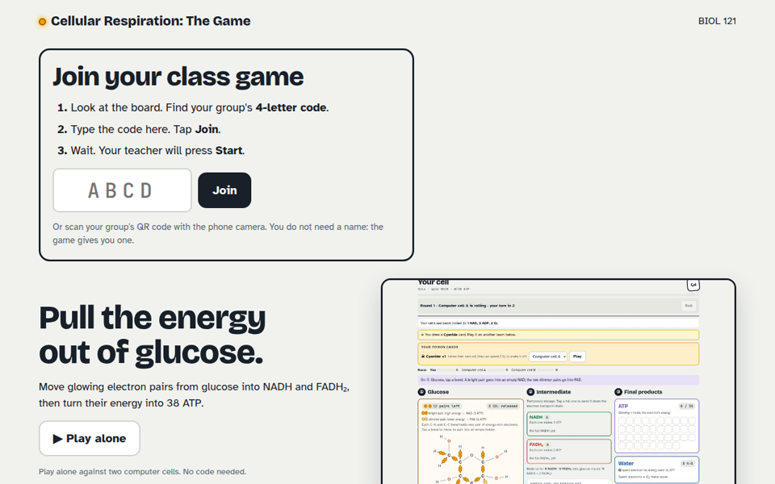
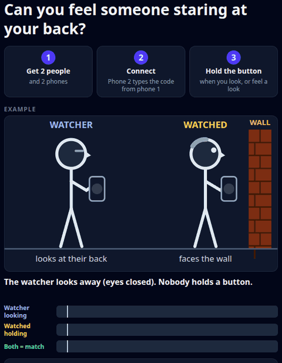

# Hi, I'm Joe Esquibel, Ph.D.

**Independent R&D engineer: program analysis, legacy modernization, and computational research.**

I'm a tenured biology professor and pharmacology researcher who taught myself software engineering over ~20 years of
increasingly computational work. Now I build tools for hard technical problems, where the standard tools aren't quite
enough and the interesting part is finding the right abstraction.

📧 **[joe@gitgalaxy.io](mailto:joe@gitgalaxy.io)** · open to R&D contracts, modernization work, and commercial licensing of GitGalaxy

---

## [GitGalaxy](https://github.com/squid-protocol/gitgalaxy): BLAST for source code

One real scan, start to finish: every number is from the scan's own output, and the clock is its real wall time.

**[Website](https://gitgalaxy.io) · [PyPI](https://pypi.org/project/gitgalaxy/) · [Documentation](https://squid-protocol.github.io/gitgalaxy/) · [Demo video](https://www.youtube.com/watch?v=XWWSd8LmoCM)**

As a scientist I used BLAST every day. It finds a gene's relatives across millions of DNA sequences in seconds by
matching short words, without first working out what the gene does. GitGalaxy applies the same idea to code. It breaks
every function, in every language, into the same structural words, with no compiler, no build, and no AI model. That
makes code comparable across languages, repositories and decades, and it works on code that doesn't even build.

One scan of a repository gives you an architecture brief for engineers and AI agents, a call and import graph, SARIF, a
CycloneDX SBOM, and a queryable SQLite knowledge graph.

**Results, each with its source:**

| | |
|---|---|
| **59 languages** read down to the function | [the full list](https://github.com/squid-protocol/gitgalaxy#languages) |
| **100% validated function precision** vs Tree-sitter, across the 31 languages it can compare | [audit of 2026-08-30](https://github.com/squid-protocol/gitgalaxy/blob/main/docs/self_scan/tri_comparison_README.md) |
| **86.7–100% call-link precision** in 8 languages, vs compiler-grade reference analysers; recall is the open gap | [graph accuracy](https://github.com/squid-protocol/gitgalaxy/blob/main/docs/graph_accuracy.md) |
| **Kubernetes (2.46M lines) in about 65 s**; most repositories in under a second | [single run, 2026-09-19](https://github.com/squid-protocol/gitgalaxy-raw-output) |

The limits are published next to the results: the numbers come from our own pinned benchmark corpora, and
[the known blind spots](https://github.com/squid-protocol/gitgalaxy/blob/main/docs/known_blind_spots.md) are listed.
We also pre-registered a test of whether code structure predicts defects. [It doesn't](https://github.com/squid-protocol/temporal-crucible); change history does.

### Study: DOOM's DNA

How much of the original game's design survives when DOOM is ported to another language? GitGalaxy mapped
linuxdoom's 16 parts (777 functions, 1,605 calls), then measured 16 programs against a shuffled baseline. The Scheme
and Go translations kept as much of the wiring as the closest C copy. Java, Kotlin and C# kept none, and rewrites
from scratch score no better than chance. It measures code shape, not gameplay, and functions are assigned to parts by
name, so it isn't a blind test. [Read the study](https://github.com/squid-protocol/gitgalaxy/blob/main/docs/wiki/museum-of-code/teardown-of-doom.md).

## Current R&D: CICS and COBOL to Java, with the evidence

Most AI modernization asks a model to translate a whole legacy application and hopes for the best. I'm building the
opposite: a translator that ports CICS and batch COBOL by fixed rules, with no AI model writing the Java. Each ported
program is then checked against the original COBOL on the same inputs for byte-identical output.

Every program gets an evidence record and a level, from L0 (inventoried) to L5 (every surviving mutant accounted for).
[Current levels](https://github.com/squid-protocol/gitgalaxy/blob/generated/docs/language_status/progress.md) are
regenerated from the code. The comparison runs on GnuCOBOL, not on a real z/OS mainframe, and I say so wherever I report
a level.

The question behind it: **how much of software transformation can be made deterministic before probabilistic AI is introduced?**

## [squid-bot](https://github.com/squid-protocol/squid-bot): a coding fleet that runs itself

GitGalaxy is largely built by a fleet of AI coding agents, and squid-bot is what keeps that fleet safe to run. I set the
goals as an ordered list of issues. squid-bot starts agents only when the machine, the CI queue and the budget can take
them, and gives each one its own isolated copy of the repo. Every change is screened, cheap checks first and the full
test suite after, and only green changes are merged. When only a human can decide something, the question goes to my
phone and the fleet keeps working on everything else.

It reports its own costs as well as its output. From Oct 19 to 25 it merged 926 small PRs that closed 193 work items.
Its first two weeks cost about $2 per merged PR and $11 per resolved issue. [The live dashboard](https://github.com/squid-protocol/squid-bot#-live-fleet-dashboard)
also tracks CI load, how often `main` broke, and what is limiting the fleet each hour.

## How I work

I turn hard questions into fast, reproducible experiments. LLMs write most of my first drafts (through squid-bot). Whether a
change stays is decided by tests, reference oracles, benchmark corpora and CI gates, and I make every claim checkable in public:

- **[Raw output](https://github.com/squid-protocol/gitgalaxy-raw-output)**: unedited scans of hundreds of real repositories
- **[Language Crucible](https://github.com/squid-protocol/language-crucible)** and **[Keyword Rosetta](https://github.com/squid-protocol/keyword-rosetta)**: the benchmark and cross-language control corpora behind the numbers above
- **[COBOL → Java examples](https://github.com/squid-protocol/cobol_to_java_examples)**: 10 COBOL repositories (as of 2026-11-04) translated into compiling Spring Boot projects
- **[Population analyses](https://github.com/squid-protocol/gitgalaxy-population-analyses)** and **[telemetry](https://github.com/squid-protocol/squid-telemetry)**: statistics over the scan population, and public usage numbers

> **If I make an interesting claim, I want the machinery needed to investigate it to be public.**

Teaching shaped this. A decade in the classroom trained me to break complicated systems into models people can follow,
and to keep asking *"what evidence would convince us?"* ([teaching portfolio](https://github.com/squid-protocol/teaching-portfolio), with 40+ student testimonials).

## Classroom science games

I still build for the classroom: phone games a whole class can play together in a few minutes, each built around one
idea students usually only hear about.

<table>
<tr>
<td width="50%" valign="top">

**[Cellular Respiration: The Game](https://glucose.fastmathfacts.io/)**: students join on their phones with a class code and race to pull the energy out of glucose, moving electron pairs into NADH and FADH₂ and turning them into 38 ATP. Built for my intro biology course. You can also play alone against two computer cells.
</td>
<td width="50%" valign="top">

**[Sixth Sense](https://sixthsense.fastmathfacts.io/)**: can you feel someone staring at your back? Two people, two phones: one holds a button while looking, the other while they feel watched. The real lesson is telling an effect from luck. Each run is scored against 999 bots that press the same way at random times, a permutation test explained in one sentence.
</td>
</tr>
</table>

## Other things I've built

Click a picture for its demo video.

<table>
<tr>
<td width="50%" valign="top">
 
<strong><a href="https://github.com/squid-protocol/help_farmers_farm">Helping Farmers Farm</a></strong>: volunteer scheduling, farm management and digital waivers for work-share CSA farms. <strong>Used by a farm for 3+ years.</strong> <a href="https://www.helpingfarmersfarm.com">Website</a>
</td>
<td width="50%" valign="top">
 
<strong><a href="https://github.com/squid-protocol/meow-turtle">Meow Turtle</a></strong>: distributed control over RS-485, with an async Python digital-twin host driving bare-metal MicroPython nodes in a small-parts sorter. 
</td>
</tr>
<tr>
<td width="50%" valign="top">
 
<strong><a href="https://github.com/squid-protocol/sorting_evolution_algorithm">Sorting evolution</a></strong>: genetic algorithms over headless physics simulation to design the vibrating sorters Meow Turtle now runs. 
</td>
<td width="50%" valign="top">
 
<strong><a href="https://fastmathfacts.io/">Fast Math Facts</a></strong>: math practice that separates mastery from effort, with millisecond timing and an international leaderboard. <a href="https://fastmathfacts.io/">Website</a>
</td>
</tr>
</table>

## What I'm looking for

Hard, poorly solved problems in **program analysis, legacy modernization, AI/LLM systems, and scientific computing**: the ones where nobody yet knows the best way to solve them.

**I'm curious by default, and I really like finding out whether an idea actually works.**

📧 **[joe@gitgalaxy.io](mailto:joe@gitgalaxy.io)**
